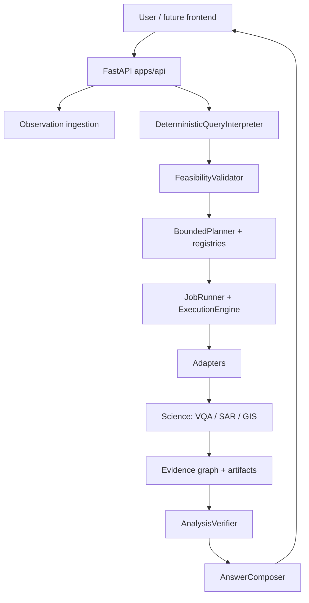
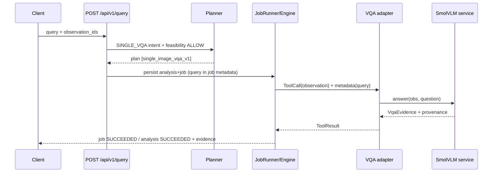

# PROJECT_OVERVIEW.md — SatQuery AI technical reference

> Comprehensive map of the **actual** repository. Status words are deliberate: **implemented** (verified here), **limited** (exists with constraints), **planned** (not runnable). See `README.md` for the short version, `INSTALLATION.md` for setup, `AGENTS.md` for agent rules, `CONTEXT.md` for the current handoff.

## 1. What is SatQuery?

Natural-language interface over satellite imagery where every scientific claim traces to typed evidence: registered model output, deterministic GIS/analytics, raster statistics, or observation metadata. Prose never creates measurements, masks, or confidence.

## 2. Problem statement

Analysts need to ask questions (“what is visible?”, “what changed?”, “how large?”) over multi-sensor, multi-temporal imagery without writing GIS/ML glue — while keeping sensor, radiometric, and geometric provenance so answers are auditable instead of hallucinated.

## 3. Goals

Deterministic interpretation; fail-closed feasibility; registry-bounded planning; durable execution; SHA/revision-pinned models; verification before answering; immutable observations/artifacts; reproducible experiments.

## 4. High-level architecture

Transport (`apps/api`), science (`satquery`, `ml`), benchmarks, and orchestration stay separated.

## 5. Repository structure

- `satquery/agent/` — `interpreter.py`, `feasibility.py`, `planner.py`, `composer.py`, `models.py` (intent/feasibility/answer contracts).
- `satquery/registry/` — `tools.yaml`, `preprocessing.yaml`, `tools.py` (executor allow-list, capability derivation), `models.py` (executor enum, registry schemas).
- `models/registry.yaml` — model revisions, checkpoint files/SHAs, preprocessing refs.
- `satquery/execution/` — `engine.py` (topological run, timeouts, cache), `jobs.py` (queue, workers, persistence), `adapters.py` (tool→science bridge), `models.py`, `cache.py`.
- `satquery/inference/` — `vqa.py` (`SmolVlmBackend`, `SingleImageVqaService`), `grounding.py`, `config.py`, `preprocessing.py`, `exceptions.py`.
- `satquery/analytics/` — deterministic SAR, spectral, temporal, measurement, reconciliation primitives.
- `satquery/ingestion/` — `FilesystemObservationStore`, raster inspection/safety limits, observation models.
- `satquery/evidence/` — `models.py` (VQA/grounding/mask/measurement/agreement/caption), `graph.py`.
- `satquery/verification/analysis.py` — evidence-graph verification. `satquery/geo/` — pairing/compatibility. `satquery/visualization/` — derivatives/tiles. `satquery/persistence/` — SQLite + repository. `satquery/reporting/`, `observability.py`, `artifacts.py`.
- `apps/api/app/` — `main.py` (factory, service wiring), `routes/` (legacy + `v1_*`), `schemas_v1.py`, `security.py`, `services/`.
- `apps/web/` — React+Vite scaffold (planned frontend; dev only, no `dist`).
- `ml/` — configs, training, offline evaluation (`phase2c_diagnostics.py`, `prepare_vrsbench_grounding.py`, `run_p4_e01.py`, …).
- `experiments/` — frozen evidence/closeouts (history — do not rewrite). `experiments/phase5_backend/backend_contract.yaml` — capability/API contract.
- `tests/` — pytest mirror of the above. `docs/` — requirements/architecture/evaluation/failure/development-plan (policy). `scripts/kaggle/` — external runners.

## 6. API layer (implemented)

Implemented routes (operation IDs in parentheses): legacy observation create (`create_observation_legacy`), tile (`raster_tile_legacy`), VQA (`single_image_vqa_legacy`), grounding (`text_guided_grounding_legacy`); v1 observations CRUD/metadata/assets/delete, pairs validate/create/list/get, `plan_query_v1`, `submit_query_v1`, analyses list/get/evidence/trace/artifacts/reproducibility/rerun, artifacts get/download/tiles/geojson, jobs get/stream-events/cancel, tools/models list/get, `list_capabilities_v1`, reports, system/health, OpenAPI at `/docs`, `/health/live`, `/health/ready`. v1 errors use a stable `{code, message, outcome, details, request_id}` envelope with `FailureOutcomeV1`.

## 7. Observation ingestion (implemented)

Upload GeoTIFF → safety inspection (size/dimension/band ceilings from env) → immutable `FilesystemObservationStore` record (`obs_<hex>`) + visualization derivative + tile service. Records carry sensor/modality, CRS/affine/bounds, band roles, radiometric tags, hashes. Rasters are untrusted input.

## 8. Query interpretation (implemented)

`DeterministicQueryInterpreter`: finite lexical rules → `QueryIntent{task_family, target_semantic, requested_measurement, temporal_direction, spatial_request, matched_rule}`. Selects data intent only (e.g. `SINGLE_VQA` for “What is visible in this image?”), never a tool; injection/negation/ambiguity → `AMBIGUOUS`.

## 9. Feasibility (implemented)

`FeasibilityValidator` runs pure gates (temporal pair/order, overlap, grid, bands, CRS, SAR semantics, image quality, capability availability) → `ALLOW / ALLOW_WITH_WARNING / REQUEST_INPUT / ABSTAIN / REJECT` with preserved checks. `SINGLE_VQA` requires capability `single_image_vqa`.

## 10. Planning (implemented)

`BoundedPlanner` maps feasible intents to ≤8-step `ExecutionPlan`s of registered tools with server-issued IDs only. `SINGLE_VQA` → one `single_image_vqa_v1` step bound to the observation; parameters stay empty (question is not a plan parameter). Unknown intents raise `WORKFLOW_UNSUPPORTED` (fail-closed, no generic fallback).

## 11. Registry system (implemented)

Tools/models/preprocessing/capabilities exist only when declared in YAML **and** allow-listed in code. Bounded parameter types only (`boolean/number/integer/enum/enum_list/server_id/roi/mask`); unsafe names rejected; duplicate keys rejected; registry hash binds plans to registry versions. `single_image_vqa` capability is `AVAILABLE_WITH_LIMITS` with `tool_ids=[single_image_vqa_v1]` + pinned `model_ids`, `contract ACCEPTED`, `runtime PROBED`, `promotion PROMOTED`.

## 12. Execution engine (implemented)

`ExecutionEngine` topologically runs validated plans (per-tool timeouts, cancellation checkpoints, artifact publication); `JobRunner` provides the bounded queue (`SATQUERY_MAX_QUEUED_JOBS`, `SATQUERY_JOB_WORKERS`), workers, SSE-resumable events, and durable analysis/job rows. Exact-key result cache exists but VQA is explicitly excluded (question lives outside the plan).

## 13. Adapters (implemented)

`SarTemporalChangeAdapter`, `MaskAreaAdapter`, `MaskAgreementAdapter`, `SingleImageVqaAdapter`: validate bindings/parameters/grid/provenance, then call exactly one science entry point. VQA adapter reads the observation binding plus `context.metadata["query"]` and delegates to the shared `SingleImageVqaService` (one checkpoint instance; lazy controlled fallback only when no service is injected).

## 14. ML inference (implemented, CPU)

`SmolVlmBackend` lazily loads the pinned checkpoint (Transformers, `float32`, `max_new_tokens` from registry), verifies SHA-256, applies the frozen prompt template over the 512×512 visualization, and generates a short answer. `SingleImageVqaService.answer(obs_id, question)` validates the question, loads the registration, preprocesses, and emits `VqaEvidence`. Default device `cpu`, `ENABLE_REMOTE_NETWORK=false`.

## 15. VQA architecture (canonical, verified)

Upload (`POST /api/v1/observations`) precedes it; status polls are `GET /api/v1/jobs/{id}` and `GET /api/v1/analyses/{id}` (+ `/evidence`). Answers are text-only with `SHIFTED`-domain reasons and baseline warnings; they never yield masks/areas/confidence.

## 16. Analytics (implemented deterministic)

SAR backscatter change (explicit domain/polarizations, verified common grid), mask-area measurement (projected/ellipsoidal), diagnostic mask agreement (IoU, agreement-not-accuracy), spectral-index and temporal-grid primitives (library-level; unregistered ones stay `NOT_IMPLEMENTED`).

## 17. Evidence model (implemented)

`VqaEvidence`, `GroundingEvidence`, `ChangeMaskEvidence`/`FloodMaskEvidence` (+ `MaskAsset`), `MeasurementEvidence` (area only), `AgreementEvidence`, `ChangeCaptionEvidence` — all with `evidence_id`, task discriminator, provenance (`operation_id`, asset, parents, timestamps), domain assessment, and warnings. Graphs (`EvidenceGraph`) persist nodes/edges per analysis.

## 18–19. Job / analysis lifecycle (implemented)

`QUEUED → RUNNING → SUCCEEDED/FAILED/CANCELLED (+INTERRUPTED)` with persisted events; analyses `PENDING → RUNNING → SUCCEEDED/ABSTAINED/FAILED/REJECTED/CANCELLED`. Verification decides `answered`; abstention carries machine-readable issue codes, never silent demo content. Rerun mints new IDs while retaining the frozen plan.

## 20. Model management (implemented)

Pin → resolve under `MODEL_ROOT` → SHA verify → load. Changing IDs/revisions/files/SHAs/preprocessing to “fix” a failure is forbidden. Current pins: SmolVLM (above); GroundingDINO-Tiny rev `a2bb814dd30d776dcf7e30523b00659f4f141c71`; BIFOLD S1/S2/joint v0.2.0 triple (see `models/registry.yaml` for SHAs).

## 21. Dataset/benchmark management (implemented)

Small RSVQA-LR smoke subset for unit tests; VRSBench grounding subset manifest pinned (12 val/24 ref + 8 test/16 ref) with images materialized on demand via `prepare_vrsbench_grounding --allow-download` (needs `[grounding]` + network). `data/`, `models/cache/` git-ignored.

## 22. Experiment phases (frozen history)

Phase 2A SmolVLM baseline; 2B scene-grouped split; 2C visual-contrast diagnostics (train/val only, intervention `visual_contrast_balanced_sampling`); Phase 3 grounding (frozen thresholds) + multisensor closeouts; Phase 4 deterministic lanes A–C `PASS`, Lane-D/OSCD plus ChangerEx/Chg2Cap/STURM `BLOCKED`; Phase 5 `RESTRICTED_CAPABILITY` backend contract. Closeouts/manifests/diagnostics are evidence — reproduce with documented generator commands; never fabricate metrics.

## 23. Reproducibility / provenance

Plan/registry hashes, input hashes, evidence/edge rows, verification payloads, artifact SHA-256, model revision/SHA + preprocessing version, and `git_sha`/timestamps on manifests. Deterministic generators must reproduce everything except volatile timestamps.

## 24. Testing architecture (implemented)

`tests/` mirrors layers: agent, registry, execution, inference, ingestion, evidence/verification, analytics, API integration, ml/phase, kaggle-runner. Deterministic/geospatial/contract tests first; no source string-matching. Run focused (`python -m pytest tests/<area>/ -q`), then full (`python -m pytest -q`), plus `git diff --check`. Observed: **733 passed, 3 warnings**.

## 25. Current limitations (implemented behavior)

Generic VLM is not remote-sensing-adapted (`SHIFTED`); SAR via generic VLM is unspecialized; JPEG/pixel-space inputs carry georeferencing warnings; numeric answers require `MeasurementEvidence`; agreement is diagnostic; blocked specialists and unregistered spectral/difference tools are unrunnable by design.

## 26. Frontend status (planned)

`apps/web/` is a React+Vite+Tailwind scaffold that consumes the stable v1 API (observations → query → jobs/analyses → evidence/tiles/reports) and must not mint IDs/measurements locally. Dev: `npm ci`, `npm run dev`. No production `dist` is checked in.

## 27. Planned architecture

Only what exists plus: frontend completion behind the same origin/CORS rules; no new K8s/Kafka/vector-DB/multi-agent layers without a demonstrated requirement. Blocked-model execution only after contracts unblock.

## 28. Development workflow

`git status` → read task sources → smallest registry-consistent fix → focused tests → full suite → `git diff --check` → report deltas, verification, and risks. No commits/pushes, force-pushes, history rewrites, secrets, datasets, or weights unless explicitly requested.

## 29. Important files

Entry: `apps/api/app/main.py`. Agent: `satquery/agent/*.py`. Registry: `models/registry.yaml`, `satquery/registry/*`, `experiments/phase5_backend/backend_contract.yaml`. Execution: `satquery/execution/*`. Science: `satquery/inference/vqa.py`, `satquery/analytics/*`. Persistence: `satquery/persistence/*`. Policy: `docs/*.md`. Config: `pyproject.toml`, `.env.example`. Handoff: `CONTEXT.md`, `AGENTS.md`.

## 30. Glossary

- Intent / feasibility / plan / job / analysis / evidence / verification / provenance / capability / executor / adapter / registry hash / plan hash / visualization derivative / common grid / sealed split — each as defined above; VQA answer text is evidence content, never a measurement source.
