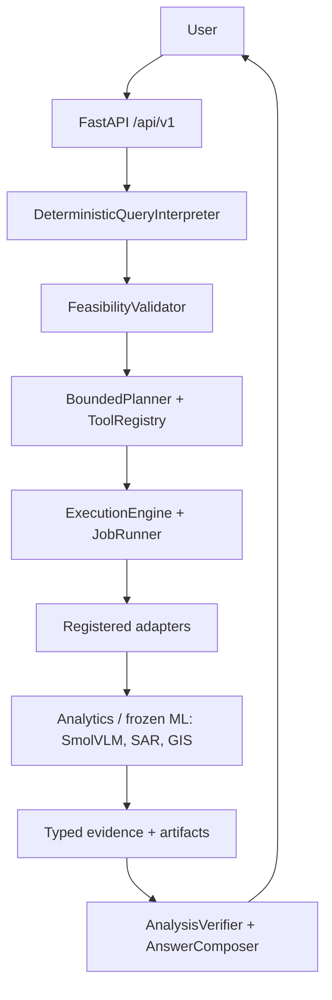

# SatQuery AI

> Evidence-grounded, sensor-aware remote-sensing analysis with a natural-language interface. The language model may explain evidence; it must not manufacture it. (SIH Problem Statement 26167.)

## What this is

SatQuery answers natural-language questions about satellite imagery by running registered, reproducible analysis and returning typed evidence — not free-text guesses. A query goes through interpretation, feasibility checks, bounded planning over a tool/model registry, durable execution, verification, and evidence composition.

Details: `PROJECT_OVERVIEW.md` · Setup: `INSTALLATION.md` · Agent rules: `AGENTS.md` · Current handoff: `CONTEXT.md`.

## Status

- Backend canonical `SINGLE_VQA` works end-to-end (observation → plan → job → `VqaEvidence`).
- Full suite observed: **733 passed, 3 warnings** (state at time of writing, not a guarantee).
- Frontend (`apps/web`): React + Vite scaffold for the canonical API; dev flow exists, no production `dist` build checked in — **planned, not finished**.

## Capabilities

**Implemented and verified:**
- Observation ingestion (GeoTIFF upload, immutable store, visualization derivatives, tiles).
- Canonical single-image VQA (`SINGLE_VQA` → `single_image_vqa_v1` → frozen SmolVLM → `VqaEvidence`), with analysis/job lifecycle and evidence endpoints.
- Deterministic analytics behind registered tools: SAR temporal change, mask-area measurement, diagnostic mask agreement (library + adapter + tests).
- Registry/capability introspection, pair compatibility, reporting/artifact/evidence retrieval, job progress/cancellation, OpenAPI docs, health probes.

**Limited / experimental:**
- Legacy `/api/vqa` and `/api/grounding` routes exist for compatibility. GroundingDINO / BIFOLD registrations exist but their runtimes are not probed in this environment.

**Planned / not runnable:**
- Spectral-index tools, generic temporal difference, automatic reprojection, PDF reports (`NOT_IMPLEMENTED` in `experiments/phase5_backend/backend_contract.yaml`).
- Learned change-captioning / structural-change / flood specialists (`BLOCKED` contracts — never exposed as runnable).

## Architecture



Numeric/spatial claims come only from deterministic/model/GIS outputs. Query text never selects executable code directly.

## Canonical VQA flow

1. Upload: `POST /api/v1/observations` → `obs_<id>` (READY, with visualization).
2. Interpret: `DeterministicQueryInterpreter` → `SINGLE_VQA` (e.g. “What is visible in this image?”).
3. Feasibility: requires `single_image_vqa` capability `AVAILABLE`/`AVAILABLE_WITH_LIMITS`.
4. Plan: `POST /api/v1/query/plan` → one step, tool `single_image_vqa_v1`, binding `{"observation": obs_<id>}`, no free-text parameters (question travels via job metadata).
5. Submit: `POST /api/v1/query` → `analysis_id` + `job_id` (`QUEUED`).
6. Execute: `SingleImageVqaAdapter` → shared `SingleImageVqaService` → pinned SmolVLM checkpoint → `VqaEvidence` (answer text + model provenance + domain warnings).
7. Verify/compose: `AnalysisVerifier` + `AnswerComposer` → analysis `SUCCEEDED`, retrievable evidence/answer.

Pinned VQA model: `smolvlm_256m_instruct_v1` = `HuggingFaceTB/SmolVLM-256M-Instruct`, revision `7e3e67edbbed1bf9888184d9df282b700a323964`, `model.safetensors` SHA-256 `74dea5904032e5ae99a2e0eef5179e6ac0f1dedc3ab0c7c2a5d4d387c843203e`, preprocessing `smolvlm_single_image_v1`. VQA results are never cached across questions.

## Repository structure

```text
satquery/            reusable science/domain package (agent, registry, execution, inference, ingestion, evidence, geo, ...)
apps/api/            FastAPI transport boundary (app factory, v1 routes, schemas, security)
apps/web/            React+Vite frontend scaffold (consumes the API; not production-built)
ml/                  offline training/adaptation/evaluation scripts
models/registry.yaml registered model revisions, hashes, preprocessing refs
satquery/registry/   tools.yaml + preprocessing.yaml + code-owned executor allow-list
experiments/         versioned scientific evidence and closeouts (frozen history — do not rewrite)
scripts/kaggle/      external GPU/data runners (thin wrappers over tested evaluators)
tests/               pytest suite mirroring the architecture
data/                local data root (git-ignored large assets; never commit datasets/weights)
docs/                requirements, architecture, evaluation, failure policy, development plan
```

## Quick start

```bash
python3 -m venv .venv
source .venv/bin/activate
pip install -e ".[dev]"
pip install -e ".[grounding]"     # only for VRSBench grounding materialization
uvicorn apps.api.app.main:app --reload
```

- Swagger: `http://127.0.0.1:8000/docs`
- Frontend dev (separate terminal): `cd apps/web && npm ci && npm run dev`
- Config: copy `.env.example` to `.env` for local overrides; leave `SATQUERY_API_KEY` blank locally. Never commit secrets.

Full guide: `INSTALLATION.md`.

## API (verified)

- `POST /api/v1/observations` — upload GeoTIFF → `{observation_id, status}`.
- `POST /api/v1/query/plan` — dry-run interpret + feasibility + bounded plan (persists nothing).
- `POST /api/v1/query` — submit → `{analysis_id, job_id, status}` (`202`, usually `QUEUED`).
- `GET /api/v1/jobs/{job_id}`, `GET /api/v1/analyses/{analysis_id}`, `GET /api/v1/analyses/{analysis_id}/evidence`, plus trace/artifacts/reproducibility/rerun routes.
- `GET /api/v1/tools`, `GET /api/v1/models`, `GET /api/v1/system/capabilities`.
- `GET /docs`, `GET /health/live`, `GET /health/ready`. Legacy: `/api/observations`, `/api/vqa`, `/api/grounding`, `/tiles`.

Example (verified against a local server):

```bash
curl -s -X POST http://127.0.0.1:8000/api/v1/query/plan \
  -H 'Content-Type: application/json' \
  -d '{"query":"What is visible in this image?","observation_ids":["obs_<id>"]}'
```

## Testing

```bash
python -m pytest tests/registry/test_tools.py -q
python -m pytest -q
git diff --check
```

Observed baseline: **733 passed, 3 warnings**. Treat as a snapshot; re-run before declaring success.

## Models and data

- `models/registry.yaml` pins every model (Hugging Face ID, 40-char revision, checkpoint file + SHA-256, preprocessing profile, `frozen: true`, `allow_remote_code: false`). `satquery/registry/preprocessing.yaml` pins preprocessing.
- Runtime resolves checkpoints under `MODEL_ROOT` (`./models` by default), including the Hugging Face cache layout `cache/models--<org>--<name>/snapshots/<rev>/<file>`, and verifies SHA-256 before loading. `ENABLE_REMOTE_NETWORK` stays `false` locally.
- Benchmarks: small RSVQA-LR subset materializes for smoke tests; the VRSBench grounding subset (12 val / 24 ref + 8 test / 16 ref) requires `python -m ml.evaluation.prepare_vrsbench_grounding --allow-download` (needs the `grounding` extra). Large archives/weights stay out of Git under `data/` and `models/cache/`.
- Phase-2C diagnostics regenerate deterministically via `python -m ml.evaluation.phase2c_diagnostics`. Sealed test splits are never used for tuning.

## Development workflow

1. `git status` + `git log --oneline -10`; read the task-relevant sources only.
2. Smallest registry-consistent change; reuse existing patterns; no speculative infra.
3. Targeted tests during iteration, full suite before finishing, `git diff --check`.
4. Never commit secrets, datasets, weights, or temp files. Never force-push or rewrite frozen `experiments/` evidence to make tests agree — report discrepancies.

Rules for automation: `AGENTS.md`.

## Future work (planned)

- Frontend completion against the stable v1 contracts (no backend bypass).
- Possible one-command setup script (no such script exists yet — use the manual steps above).
- Blocked learned specialists only after their dataset/checkpoint contracts unblock; no timeline promised.
